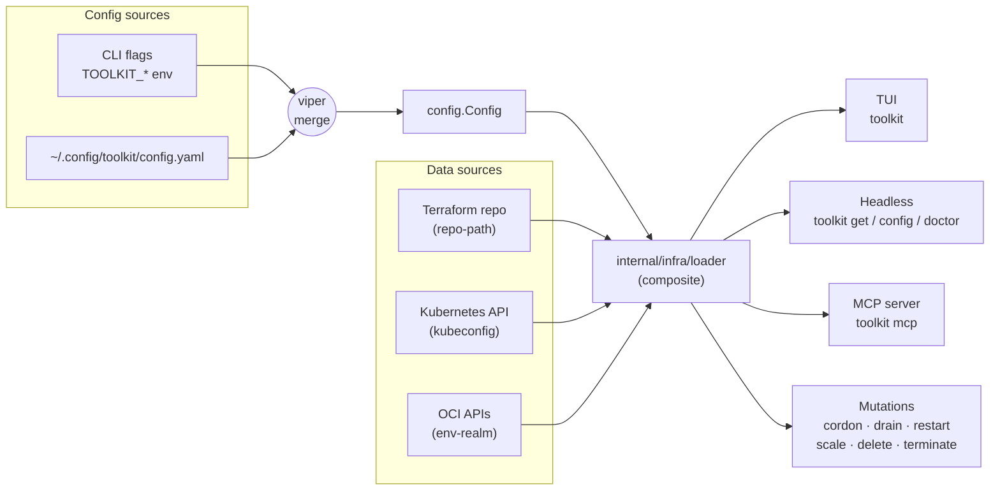

# Toolkit

[](https://github.com/jingle2008/toolkit/actions/workflows/ci.yml)
[](https://goreportcard.com/report/github.com/jingle2008/toolkit)
[](https://pkg.go.dev/github.com/jingle2008/toolkit)
[](https://codecov.io/gh/jingle2008/toolkit)

Toolkit is a collection of reusable Go components exposed through a modular CLI and optional TUI (built with [Bubble Tea](https://github.com/charmbracelet/bubbletea)).  
It targets day-to-day DevOps & development automation: querying Kubernetes, parsing Terraform plans, mass-editing config files, and inspecting large data tables directly in your terminal.

- [User Manual](docs/USER_MANUAL.md)
- [Kubernetes Client Fakes & Testing Patterns](docs/guide/k8s-fake-patterns.md)

---

## Feature Highlights

| Area           | Packages                        | Notes |
| -------------- | ------------------------------- | ----- |
| **CLI core**   | `internal/cli`                  | Cobra-based, flags auto-generated |
| **Interactive TUI** | `internal/ui/tui`             | Sort/search/filter large tabular datasets; **live updates** (`● LIVE`) as cluster and config change; a fuzzy **command palette** (`:`) and a row **preview pane** (`v`) |
| **Infrastructure loaders** | `internal/infra/k8s`, `internal/infra/terraform` | Uniform abstraction for K8s & TF |
| **Live watches** | `internal/infra/k8s` (cluster), `internal/infra/fswatch` (repo working tree) | Debounced triggers reload the view automatically; preserves filter & cursor |
| **Config loading & validation** | `internal/config`, `internal/configloader` | JSON / YAML with defaulting & schema checks |
| **Collections helpers** | `internal/collections` | Generic filter/sort with predicates |
| **Encoding helpers** | `internal/encoding/jsonutil` | Fast JSON pointer traversal |
| **Error & logging** | `internal/logging` | Typed errors via std errors; log/slog logger |

## Architecture at a glance



The loader composite is the single funnel every entry point goes through, so the four surfaces (TUI, headless `get`, MCP, mutations) all see identical data and the same partial-load semantics.

---

## Install

```bash
# Latest release
go install github.com/jingle2008/toolkit/cmd/toolkit@latest

# From source
git clone https://github.com/jingle2008/toolkit.git
cd toolkit && make
```

```zsh
# From Homebrew (macOS/Linux)
brew install jingle2008/tap/toolkit
```

> **Already on the old `jingle2008/homebrew-toolkit` tap?** It's archived as of v0.3.x and won't receive new releases. Migrate with (order matters — `brew untap` refuses while the formula is still installed):
> ```zsh
> brew uninstall toolkit
> brew untap jingle2008/toolkit              # canonical short name; the homebrew- prefix is implied
> brew install jingle2008/tap/toolkit
> ```

---

## Getting Started

After installation, try these quick commands:

```sh
toolkit init
# Scaffold an example config file at ~/.config/toolkit/config.yaml

toolkit config --validate
# Sanity-check the effective config; exits non-zero on failure

toolkit completion bash   # or zsh/fish
# Output shell completion script for your shell

toolkit version --check-updates
# Print your installed version and check for updates
```

---

## Usage

```bash
toolkit --help                # all global flags
```

### Global Flags

| Flag | Default | Description |
| ---- | ------- | ----------- |
| `--config` | `~/.config/toolkit/config.yaml` | Path to config file (YAML or JSON) |
| `--repo-path` |  | Path to the repository |
| `--env-type, -t` |  | Environment type (e.g. dev, prod); `ppe` is accepted for `preprod` |
| `--env-region, -r` |  | Environment region — full identifier (`us-phoenix-1`) or 3-letter code (`phx`) |
| `--env-realm, -m` |  | Environment realm |
| `--category, -c` |  | Category to display |
| `--filter, -f` |  | Initial filter for current category |
| `--metadata-file` | `~/.config/toolkit/metadata.yaml` | Optional additional metadata file |
| `--kubeconfig` | `~/.kube/config` | Path to kubeconfig file |
| `--log-dir` | `~/.local/state/toolkit/logs` | Directory for per-session log files (honors `$XDG_STATE_HOME`) |
| `--log-file` |  | Write logs to this single file instead of per-session files |
| `--debug, -d` | `false` | Enable debug logging |
| `--log-format` | `console` | Log format: `console` or `json` (`slog`: deprecated alias of `json`) |
| `--log-level` | | Minimum log level: `debug`, `info`, `warn`, `error` (empty uses `--debug` flag) |
| `--mutation-env-override-allowed` | `false` | Allow MCP mutation tools to override the startup env per call (off by default for safety) |
| `--mcp-read-only` | `false` | Start `toolkit mcp` with only the read tools (plus `get_drain_status`); mutation tools aren't registered |

*(See `internal/cli/flags.go` for the authoritative list.)*

### Headless `get` (for scripts and LLM integration)

`toolkit get <category>` is the non-TUI equivalent of selecting a category in the interactive UI. It uses the same loaders and emits machine-friendly output for piping into `jq`, posting to LLM tools, feeding spreadsheets, or driving shell pipelines.

Supported formats (`-o`): `table` (default), `json`, `jsonl`, `yaml`, `csv`, `tsv`.

```bash
# JSON array (default pretty-printed)
toolkit get tenant -o json

# Line-delimited JSON (great for streaming / `xargs`)
toolkit get gpunode -f us-ashburn-1 -o jsonl

# Plain table (default)
toolkit get dac

# YAML
toolkit get basemodel -f cohere -o yaml

# CSV for spreadsheets (proper quoting via encoding/csv)
toolkit get tenant -o csv > tenants.csv

# TSV for `cut` / `awk` pipelines
toolkit get gpupool -o tsv | cut -f1,3

# Suppress headers (table/csv/tsv)
toolkit get tenant --no-headers

# Only rows related to one parent row — the same relations as the TUI's drill-in
toolkit get gpuworkload --related-to dac/<dac-name>
toolkit get inferenceservice --related-to servingruntime/<runtime> -o json
toolkit get dac --related-to tenant/<tenant-name>

# Only faulty rows — what the TUI's Ctrl+Z shows
toolkit get gpunode --faulty
toolkit get inferenceservice --faulty -o json

# One row by name, as an object (default -o yaml)
toolkit get dac <dac-name>
toolkit get inferenceservice <namespace>/<name> -o json
```

With a name, `get` prints just that row: the name must match the row's first column exactly, or be `<group>/<name>` when rows in different groups share it (an override's name across tenants, an endpoint's across namespaces); a service tenancy's name repeats across realms, so it takes `<realm>/<name>`; a model artifact built for several GPU configs is one row per config, so it takes `<model>/<name>@<config>` (e.g. `@2xH100`). No match, or several, exits non-zero and says which; `--filter` is the loose match.

`--related-to <category>/<name>` keeps the rows related to that parent row, using the relations the TUI drills through: a DAC's pods, a model's or runtime's endpoints, a tenant's DACs, pods and endpoints, a definition's overrides, and so on. The name must match the parent row's first column exactly (case-sensitive). The flag combines with `--filter`, and an unrelated category is rejected with the valid parents listed. Shell completion offers the valid `<category>/` prefixes.

`--faulty` keeps the rows the TUI's Ctrl+Z shows: rows in a bad state (an unready endpoint, a pool short of its declared size, a deleting tenant, …) or naming a parent row that doesn't exist, as `doctor --relations` reports. It applies to `basemodel`, `tenant`, `gpupool`, `gpunode`, `gpuworkload`, `servingruntime`, `dac` and `inferenceservice`, combines with `--filter` and `--related-to`, and loads every category, so it needs the cluster. For `gpupool` it also needs OCI, since a pool's live size decides; without it the command fails rather than list every pool.

Category aliases match the TUI (`t`, `bm`, `gn`, `dac`, …). Run `toolkit get alias` for the full list, or enable shell completion (`toolkit completion zsh`) for tab-completion. Logs go to a per-session file (see [Logging](#logging)) so stdout stays clean for parsing.

For `gpunode`, `dac`, `modelartifact`, and the tenancy-override categories, the structured outputs (`json`, `jsonl`, `yaml`) are a flat array of objects with the originating group key injected as `pool`, `tenant`, or `model` — easier for `jq` and LLM consumers than the previous map-shaped output.

### Inspect effective config (`toolkit config`)

`toolkit config` prints the merged view every other subcommand sees — defaults + `TOOLKIT_*` env + config file + flags — so you can see what's actually in effect without opening the YAML by hand:

```bash
toolkit config                    # YAML (default)
toolkit config -o json            # JSON for `jq`
toolkit config --pretty=false     # compact JSON
toolkit config --validate         # run config.Validate(); exit non-zero on failure
```

`--validate` mode emits a structured `{valid, config_file, error?}` payload and exits non-zero on failure — suitable for `if ! toolkit config --validate; then abort; fi` precondition checks in CI/scripts.

### Metrics dashboards (`toolkit metrics`)

`toolkit metrics <category> <name>` prints the OCI Telemetry dashboard URL the TUI's metrics key (`m`) opens: the last 7 days of the metrics the served model's capability calls for, scoped to the DAC (dedicated) or the model (on-demand). It works for `dac`, `importedmodel`, `gpuworkload` and `inferenceservice`; `<name>` matches as in `get <category> <name>`.

```bash
toolkit metrics dac <dac-name>
toolkit metrics inferenceservice <namespace>/<name>
toolkit metrics importedmodel <name> --dac <dac-namespace>   # a model several DACs serve
open "$(toolkit metrics dac <dac-name>)"
```

A row with no dashboard — no model, or a capability with no metrics — fails with the reason, as the TUI's toast does.

### Cluster mutations

Maintenance operations the TUI exposes via keyboard shortcuts are also available as scriptable subcommands. All mutations support `--dry-run` / `-n` (look the target up as a real call would, and preview the action: a node, DAC or pool that doesn't exist fails the dry run) and `--yes` / `-y` (skip the interactive prompt). Each call writes a JSON line to the audit log.

| Command | Effect |
| ------- | ------ |
| `toolkit cordon <node>` / `toolkit uncordon <node>` | Toggle scheduling on a Kubernetes node |
| `toolkit drain <node>` | Safely drain a node: cordon, refuse nodes running fine-tuning / training / replicationJob pods, rolling-restart single-replica InferenceServices so they move off first, then evict the rest. Blocks until done; the drain is recorded on the Node (`toolkit/drain` annotation), so re-running resumes an interrupted drain. `--status` prints the recorded drain instead (phase, deadline, what it still waits on; `-o yaml\|json`), as MCP's `get_drain_status`. |
| `toolkit restart node <node>` | Soft-reset (restart) the node's underlying OCI instance. `--ocid <instance>` skips the node lookup (for a node that left the cluster) but needs `--repo-path`: the instance must be in one of the env's GPU pools, in the GPU compartment the cluster's GPU nodes are in, and the prompt, dry run and audit name the OCID |
| `toolkit restart inference-service <name> [--namespace <ns>]` | Rolling-restart an OME InferenceService by bumping its `restartedAt` annotation. Without `--namespace`, the name must be unique across namespaces. Alias `isvc`. |
| `toolkit scale gpu-pool <name> [--add N]` | Without `--add`, fill the OCI instance pool to the Terraform-declared size (nothing to do when it's there). `--add N` adds N instances to OCI's current size, past the Terraform size if need be; the next `terraform apply` shrinks it back, which the prompt and `--dry-run` warn about. The `gpupool` alias is accepted for back-compat. |
| `toolkit delete dac <name>` | Delete a dedicated AI cluster (destructive — requires `--yes`) |
| `toolkit delete inference-service <name> [--namespace <ns>]` | Delete an orphaned InferenceService — a dedicated endpoint whose DAC no longer exists. Refused for shared endpoints and for endpoints whose DAC exists. One stuck deleting for over 10 minutes is force-deleted by removing its finalizer. Destructive — requires `--yes`. Alias `isvc`. |
| `toolkit terminate <node>` | Terminate the underlying OCI instance (destructive — requires `--yes`). `--ocid` as for `restart node` |

Example:

```bash
toolkit drain node-42 --dry-run     # preview
toolkit drain node-42 -y            # run without prompt
```

See [docs/recipes.md](docs/recipes.md) for end-to-end flows (MCP setup, maintenance windows, audit exports, Slack digests).

### MCP server (`toolkit mcp`)

For agent integration via the [Model Context Protocol](https://modelcontextprotocol.io), `toolkit mcp` boots a stdio MCP server that exposes the same loader surface as `get` — but as typed tools an AI agent can call directly, no shell-out needed.

Configure once in your MCP client. Claude Desktop / Claude Code use JSON:

```jsonc
{
  "mcpServers": {
    "toolkit": {
      "command": "toolkit",
      "args": ["mcp"]
    }
  }
}
```

Codex CLI (`~/.codex/config.toml`) uses TOML:

```toml
[mcp_servers.toolkit]
command = "toolkit"
args = ["mcp"]
```

See [docs/recipes.md](docs/recipes.md) for the per-client file paths and first prompts to try.

**Read tools** — return a `{ "items": [...], "count": N, "warnings": [...] }` envelope:

| Tool | Description |
| ---- | ----------- |
| `list_tenants` | Tenants in the configured realm |
| `list_base_models` | Base models from the cluster |
| `list_serving_runtimes` | OME ClusterServingRuntime CRs (hardware, image, limits) |
| `list_gpu_pools` | GPU pools (partial-load warnings surfaced) |
| `list_gpu_nodes` | GPU nodes (flat, with `pool` field) |
| `list_dacs` | Dedicated AI clusters (flat, with `tenant` field) |
| `list_inference_services` | OME InferenceService CRs (flat, with `namespace` and `type` fields) |
| `list_environments` | All known toolkit environments |
| `list_service_tenancies` | Service tenancies from the repo |
| `list_model_artifacts` | Model artifacts (flat, with `model` field) |
| `list_definitions` | `kind`: `limit` / `console_property` / `property` |
| `list_tenancy_overrides` | Same `kind` enum, tenancy-scoped |
| `list_regional_overrides` | Same `kind` enum, region-scoped |
| `list_related` | Rows of `category` related to one parent row (`parent_category` + `parent_name`), e.g. a DAC's pods or a runtime's endpoints. Same relations as the TUI drill-in and `toolkit get --related-to` |
| `list_aliases` | Discovery — every category alias |

| `get_item` | The one row of `category` named exactly `name` — the full object its list tool returns, as `toolkit get <category> <name>`: a name shared across groups is refused with each candidate as `<group>/<name>`, which picks one. No match is an error |
| `metrics_url` | The OCI Telemetry dashboard URL for a DAC, imported model, GPU workload or inference service, with the capability and filter it uses — as `toolkit metrics` and the TUI's metrics key |
| `check_integrity` | Every relation checked, as `toolkit doctor --relations`: per relation, rows checked, every row naming a missing parent, and a `hint` on fixing them; `status` PASS / FAIL / WARN |

The tools for the categories whose rows can be faulty (`list_base_models`, `list_tenants`, `list_gpu_pools`, `list_gpu_nodes`, `list_gpu_workloads`, `list_serving_runtimes`, `list_dacs`, `list_inference_services`) also take `faulty: true`: only the rows the TUI's Ctrl+Z shows, as `toolkit get --faulty`. `list_inference_services` with `faulty: true` is how an agent finds the orphaned endpoints `delete_inference_service` removes. `list_related` takes `faulty: true` too, for the faulty rows within one parent (a DAC's unready endpoints), as `toolkit get --related-to … --faulty` and Ctrl+Z inside a TUI drill-in.

Every read tool takes an optional `filter` (fuzzy substring) and optional `env_type` / `env_region` / `env_realm` to override the startup env per-call, so a single running server can answer questions across multiple environments.

**Mutation tools** — gated on `confirm: true`. The same safety model as the CLI: failures surface as a tool error (`isError` plus the underlying cause), every call writes to the audit log. `dry_run: true` (no `confirm` needed) looks the target up as a real call would and returns `status: "DRY_RUN"` with what it found under `resolved` (the node's instance or cordon state, its drain phase, the pool's sizes, the DAC's OCID and state, the InferenceService's namespace and planned delete vs force-delete, whether a tenant entry exists) without acting; a target that doesn't exist fails the dry run. A line on stdin that isn't a JSON-RPC message gets a JSON-RPC error (`-32700` / `-32600`) and the session goes on; batches aren't supported. The irreversible tools — `terminate_node`, `delete_dac`, `delete_inference_service` — also need `confirm_target` set to the target, as named or as the dry run reports it: `confirm: true` alone is refused, as the CLI requires `--yes` and the TUI a capital `Y` for them.

| Tool | Effect |
| ---- | ------ |
| `cordon_node` / `uncordon_node` | Mark a node unschedulable / schedulable |
| `drain_node` | Start (or resume) the same safe drain as the CLI; returns at once and the server drives it in the background |
| `get_drain_status` | Read-only, no `confirm` needed: a node's drain phase, deadline, what it still waits on, and any failure message |
| `restart_node` | Soft-reset (restart) the node's underlying OCI instance |
| `restart_inference_service` | Rolling-restart an OME InferenceService (`namespace` optional) |
| `scale_gpu_pool` | Grow an OCI GPU instance pool: to its Terraform size, or by `add` instances past it (status `NOOP` when there's nothing to do) |
| `delete_dac` | Delete a dedicated AI cluster (irreversible: needs `confirm_target`) |
| `delete_inference_service` | Delete an orphaned InferenceService (its DAC is gone); force-deletes one stuck deleting (`namespace` optional; irreversible: needs `confirm_target`) |
| `terminate_node` | Terminate the underlying OCI instance (irreversible: needs `confirm_target`). With `ocid`, the instance must be in one of the env's GPU pools, and `confirm_target` is the OCID |

By default, mutation tools ignore any per-call `env_type` / `env_region` / `env_realm` (MCP tool input fields — these stay snake_case as the JSON-schema field names) and only act in the startup env — the operator's credentials decide the maximum blast radius, not the agent. Pass `--mutation-env-override-allowed` at server start to opt in to per-call env routing.

To give an agent read access only, start the server with `--mcp-read-only` (or `mcp-read-only: true` in the config file, or `TOOLKIT_MCP_READ_ONLY=true`). The mutation tools are then not registered at all, so no prompt can reach one; `get_drain_status` stays, so the agent can still watch a drain started elsewhere.

---

## Project Layout

```
.
├── cmd/
│   └── toolkit/            # main()
├── internal/
│   ├── cli/                # cobra root & sub-commands
│   ├── ui/tui/             # Bubble Tea models & views
│   ├── infra/
│   │   ├── k8s/            # K8s data sources
│   │   └── terraform/      # Terraform provider
│   ├── config/             # typed config structs
│   ├── configloader/       # env + file loader
│   ├── logging/            # log/slog logger, fan-out, TUI log ring
│   ├── collections/        # generic filter/sort
│   └── encoding/jsonutil/  # JSON helpers
├── pkg/
│   └── models/             # domain models and types
└── test/
    └── integration/
```

---

### Build

```sh
make
```
or
```sh
go build -o bin/toolkit ./cmd/toolkit
```

### Run

```sh
./bin/toolkit --help
```
or, if built with Go:
```sh
go run ./cmd/toolkit --help
```

## Testing

Run all tests with:
```sh
go test ./...
```

#### Running tests

- Unit tests (default):
  ```sh
  make test
  ```
- Integration tests (with build tag):
  ```sh
  make test-int
  ```
- Coverage reports:
  ```sh
  make cover      # unit test coverage
  make cover-int  # integration test coverage
  ```

#### Continuous Integration

- **Unit tests** run on all pushes and pull requests.
- **Integration tests** run on pushes to `main` and nightly (see `.github/workflows/ci.yml`).
- **CI target**: Run `make ci` to execute both lint and test in one step (recommended for local and CI use).

## Developer Workflow

- Dev tools (golangci-lint, gofumpt, goimports) are pinned in `tools/go.mod` and run via `go tool -modfile=tools/go.mod <tool>` — nothing to install. `make setup` optionally prebuilds them.
- Optional: enable git hooks with pre-commit (both hook types — govulncheck runs on pre-push):
  `pre-commit install --hook-type pre-commit --hook-type pre-push`
- Run `make ci` before pushing to ensure code passes lint and tests.
- Use `make lint` to check for style and static analysis issues.
- Use `make test` for a full race-enabled test run.
- Use `make fmt` and `make tidy` to auto-format and tidy dependencies.

## Architecture Overview

Toolkit follows a modular, testable architecture:
- **Loaders**: `internal/infra/loader` provides concrete and interface-based loaders for datasets (K8s, Terraform, OCI), enabling dependency injection and testability.
- **TUI Model**: `internal/ui/tui` contains Bubble Tea models, views, and update loop; composed via functional options.
- **Domain types**: `pkg/models` defines strongly-typed domain models used across loaders and UI.
- **Category enum**: `internal/domain/category.go` provides strongly-typed categories and parsing.
- **Logging**: `internal/logging` builds a `log/slog` logger with configurable format and file path, fanned out to the TUI log view.

## Logging

Toolkit uses Go's [log/slog](https://pkg.go.dev/log/slog) for structured, machine-readable logging; each line carries its source location, and client-go's klog output is routed into the same log. Every toolkit process (TUI, `get`, `mcp`, mutations) logs to its own session file, `<start>-<cmd>-<pid>.log`, in `~/.local/state/toolkit/logs` (`$XDG_STATE_HOME/toolkit/logs` when set, `%LocalAppData%\toolkit\logs` on Windows; change it with `--log-dir`), so concurrent instances never share a file. Exited sessions beyond the newest 50 of their command, or idle for 14 days, are pruned when the next one starts. `toolkit logs` prints the latest session (`--follow` to tail it, `--cmd mcp` to pick by command, `toolkit logs ls` to list them). `--log-file` writes to one file instead. Logs support `--log-format` of `console` (key=value text) or `json` (`slog` is a deprecated alias of `json`). The minimum log level can be set via `--log-level` (`debug`, `info`, `warn`, `error`).

## Contributing

Contributions are welcome! Please open issues or submit pull requests for new features, bug fixes, or improvements.

---

## License

This project is licensed under the MIT License.
